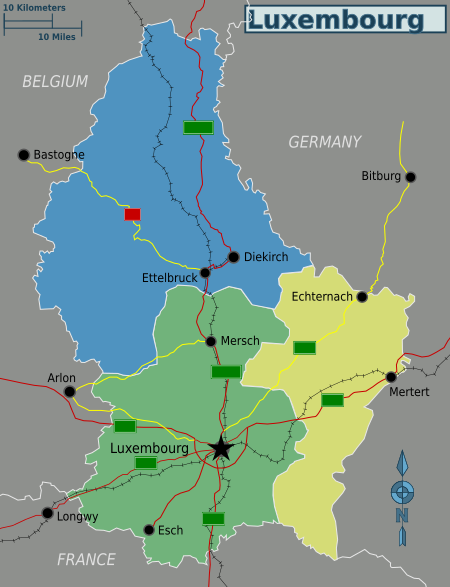

# Luxembourg SVG regression corpus

These are untrusted test inputs. Run them through the sanitizer; do not open the
attack variants directly in a browser or embed them in a website. Scripts use
test markers, remote references use the reserved `example.invalid` domain, and
file references target a fictitious `/__svg_sanitize_test__/never-read.txt` path.
The entity-expansion sample is deliberately bounded to 16 short strings.

## Source and artwork license

`source.svg` is the unmodified map supplied for these tests, downloaded from
[Wikimedia Commons](https://commons.wikimedia.org/wiki/File:Luxembourg.svg):

- Original file: <https://upload.wikimedia.org/wikipedia/commons/9/91/Luxembourg.svg>
- Author: [Shaund (Shaundd)](https://commons.wikimedia.org/wiki/User:Shaundd),
  Russian translation by [Peter Fitzgerald](https://commons.wikimedia.org/wiki/User:Peterfitzgerald).
- Commons credits the work as based on a map from the Perry-Castaneda Library.
- Commons reports [CC BY-SA 4.0](https://creativecommons.org/licenses/by-sa/4.0/).
  A copy of the license is in [CC-BY-SA-4.0.txt](CC-BY-SA-4.0.txt).
- SHA-256: `072eda1ef64aad298a6c3c28498bebb2142d8bbcbc0bd771a604875aff531eac`

All SVG artwork and rendered comparison images in this directory are distributed
under CC BY-SA 4.0, separately from the repository's MIT-licensed Python code.
Each generated attack/control SVG includes an attribution, license link, and modification notice.
Sanitized preview SVGs omit metadata by design; their attribution and license
are provided by this README and the bundled license.
No endorsement by the map's authors is implied.

`clean.svg` keeps the original coordinate system and the exact path data of the
three colored regional outlines (`path4517`, `path4519`, `path4521`), plus the
capital label and its original position. Selected CSS presentation values are
converted to SVG attributes; other layers, symbols, embedded imagery, and editor
metadata are omitted. This compact base avoids repeating the entire 915 KB
original in every attack fixture. The full original is also tested independently.
The compact-map tests check structural preservation; a separate full-map render
comparison checks visual mode's appearance against the original.

## Visual comparison

| Original map | Strict mode (default) | Visual mode |
| --- | --- | --- |
|  |  |  |

The previews show why primitive-only reconstruction loses detail: the original
stores colors, line widths, fonts, and hidden-layer settings in inline styles.
`mode="visual"` converts validated declarations to attributes and preserves the
map's sanitized local railway marker. It keeps external images and unsupported
resources removed. The original's unresolved image belongs to a hidden layer.

Download the [strict SVG](preview/strict.svg) or [visual SVG](preview/visual.svg)
to inspect the actual outputs. Previews were produced with Inkscape; their
[metrics](preview/metrics.json) compare each output with the original using the
same renderer and fonts. The image test permits at most 2% of pixels to differ
by more than 8 channel levels, limits normalized mean channel error to 0.005,
and requires at least a 100-fold improvement over strict mode's mean error.
This is a regression for this map, not a fidelity guarantee for arbitrary SVGs.

To regenerate previews, install Inkscape, DejaVu fonts, and `pip install -e '.[test,render]'`,
then run `python tools/render_luxembourg.py` from the repository root. The helper
checks the source checksum and renders only the original and sanitized outputs.
It does not render attack variants. The render comparison runs in a dedicated
CI job; other tests do not require a renderer.

## Cases

All attack files are standalone derivatives of `clean.svg`. Library and CLI
attack regressions exercise both strict and visual modes.

| Fixtures | Use case | Expected result |
| --- | --- | --- |
| `inline-script.svg`, `external-script.svg` | Inline CDATA scripts and external scripts using `href`, `xlink:href`, and `src` | Remove scripts; preserve the compact map |
| `event-handlers.svg` | Root load handler, path click/hover handlers, character-reference encoding | Remove handlers; preserve the compact map |
| `links.svg` | JavaScript, encoded JavaScript, HTTPS, and data-URL links | Remove complete link subtrees |
| `images.svg` | Remote images, remote SVG, percent-encoded and base64 SVG data URLs | Remove images |
| `use-and-defs.svg` | Local/external clones, symbols, filters, patterns, gradients | Remove references and definitions |
| `css.svg` | CSS import, font loading, external/local paint URLs, inline style | Remove CSS and paint references |
| `foreign-object.svg` | HTML scripts, iframe, form, and image handler inside `foreignObject` | Remove the complete subtree |
| `animation.svg` | SMIL `animate`, `set`, transforms, and motion references | Remove animation subtrees |
| `namespace-spoofing.svg` | Foreign SVG-like names, XHTML SVG, namespace reset, namespaced event attribute | Remove foreign subtrees and attributes |
| `xml-base-and-xinclude.svg` | Base URL rewriting and remote/local XInclude | Remove base attribute and includes |
| `hidden-subtrees.svg` | Payloads inside metadata, symbols, and unknown containers | Remove complete unsupported subtrees |
| `processing-instructions.svg` | External stylesheet and XML model instructions | Drop processing instructions |
| `text-controls.svg` | Bidi/formatting and C1 control characters in the capital label | Restore the plain `Luxembourg` label |
| `invalid-values.svg` | Nonfinite coordinates, malformed transform, opacity outside its range, invalid dash list, font URL | Drop invalid attributes; preserve the compact map |
| `escaped-text.svg` | Escaped markup and ampersand in a visible label | Preserve literal text with XML escaping, never create a script element |
| `doctype.svg`, `external-dtd.svg` | Internal/external document type declarations | Reject the document |
| `file-entity.svg`, `remote-entity.svg`, `entity-expansion.svg` | File/remote external entities and bounded nested expansion | Reject the document |
| `malformed.svg`, `wrong-namespace.svg` | Broken XML and a non-SVG root namespace | Reject the document |
| `deep-nesting.svg`, `too-many-nodes.svg` | Excessive depth or element count in otherwise removable metadata | Reject under default limits |
| `too-many-attributes.svg`, `oversized-attribute.svg`, `oversized-text.svg` | Per-node attribute count, attribute length, aggregate text limits | Reject under default limits |

For cases expected to preserve the compact map, tests compare the entire sanitized
output with the clean control. Separate assertions anchor that control to the
original paths, colors, dimensions, and capital label, so dropping all content
cannot pass. Tests cover both bytes and text inputs, idempotence, custom byte/path
limit boundaries, and CLI success, rejection, and preservation of existing output.
No test downloads files or executes the embedded payloads. Only the separate
render comparison renders SVG, using the pinned original and sanitizer outputs.

## Regeneration

With the project's test dependencies installed, run from the repository root:

```sh
python tests/fixtures/luxembourg/generate.py
python tests/fixtures/luxembourg/generate.py --check
python -m pytest -q tests/test_luxembourg.py
```

Generation verifies the original source checksum, extracts the map directly from
that source without invoking the sanitizer, and writes deterministic fixtures.
`--check` verifies the committed files without modifying them. The generator is
the readable definition of the long resource-limit payloads. Neither generation
nor testing needs network access.
